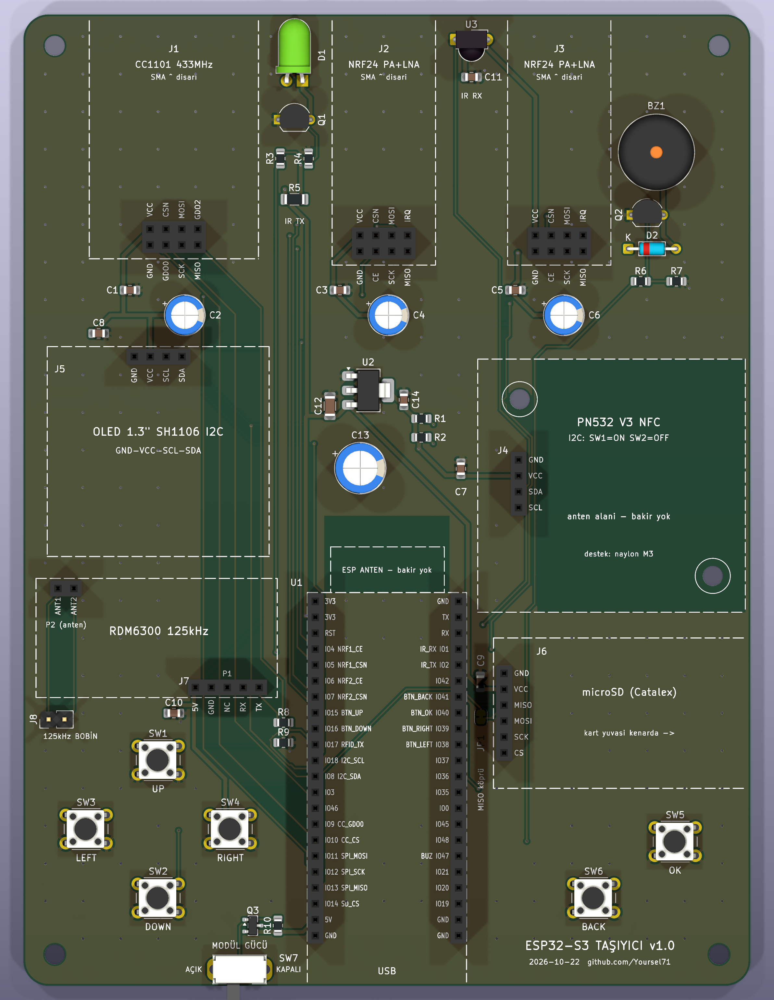

# ESP32-S3 Taşıyıcı Kart (KiCad 10)

ESP32-S3-DevKitC-1 (N16R8) tabanlı, 2 katmanlı, elde taşınır taşıyıcı PCB. Tüm modüller 2,54 mm dişi header soketlerine takılır; kartın üzerinde yalnızca soketler, butonlar, güç devresi ve pasifler var.



| | |
|---|---|
| Kart | 116 × 155 mm, 2 katman, 1,6 mm FR4, R4 yuvarlatılmış köşe, 4× M3 delik (kenardan 5 mm) |
| ERC | **0 hata, 0 uyarı** (`cikti/ERC_raporu.rpt`) |
| DRC | **0 ihlal, 0 bağlanmamış pad, şema–PCB uyumu tam** (`--schematic-parity --severity-all`, `cikti/DRC_raporu.rpt`) |
| Yönlendirme | Freerouting 2.5.0, %100 yönlendirildi; iki katmanda GND dökümü + 232 dikiş via |
| İz / boşluk | sinyal 0,25 mm, güç 0,6 mm, GND 0,5 mm; boşluk 0,20–0,25 mm; via 0,6/0,3 ve 0,8/0,4 mm. Pad girişlerindeki inceltmeler 0,20 mm'ye genişletildi; tek bir iz (IR_RX) 0,187 mm kaldı, kural alt sınırı 0,15 mm (6 mil, standart üretici kapasitesi) |

## Dosyalar

| Dosya | İçerik |
|---|---|
| `ESP32S3_Tasiyici.kicad_pro / .kicad_sch / .kicad_pcb` | KiCad 10 projesi |
| `Tasiyici.kicad_sym`, `Tasiyici.pretty/` | Projeye özel semboller ve modül soket footprint'leri (modül gövdesi Fab + courtyard'da) |
| `cikti/ustten_render.png`, `perspektif_render.png`, `alttan_render.png` | 3B render'lar |
| `cikti/montaj_1-1.pdf` | **1:1 montaj kontrol çizimi** (A4, ölçeksiz, 50 mm kontrol çubuğu) |
| `cikti/bakir_katmanlari_1-1.pdf` | Üst ve alt bakır, 1:1 |
| `cikti/sema.pdf` | Şema |
| `cikti/ERC_raporu.rpt`, `cikti/DRC_raporu.rpt` | Kontrol raporları |
| `cikti/gerber_ESP32S3_Tasiyici.zip` | Üretim dosyaları (Gerber + Excellon) |
| `cikti/BOM.csv` | Malzeme listesi |
| `scripts/` | Her şeyi tek kaynaktan (`tasarim.py`) yeniden üreten betikler |

## Pin haritası (ESP32-S3)

| Fonksiyon | GPIO |
|---|---|
| I2C SDA / SCL (OLED + PN532) | IO8 / IO18 (4,7k pull-up → +3V3_MOD) |
| SPI MOSI / SCK / MISO (CC1101, microSD, 2× NRF24) | IO11 / IO12 / IO13 |
| CC1101 CS / GDO0 | IO10 / IO9 |
| microSD CS | IO14 |
| NRF24 #1 CE / CSN | IO4 / IO5 |
| NRF24 #2 CE / CSN | IO6 / IO7 |
| IR alıcı VS1838B | IO1 |
| IR LED (Q1 PN2222A, 220 Ω baz) | IO2 |
| Pasif buzzer (Q2 sürücü) | IO47 |
| Butonlar UP / DOWN / LEFT / RIGHT / OK / BACK (GND'ye çeker) | IO15 / IO16 / IO38 / IO39 / IO40 / IO41 |
| RDM6300 TX (bölücüyle 5 V → 3,4 V) | **IO17** (istekte pin yoktu, eklendi) |
| Kullanılmayan | 0, 3, 19, 20, 21, 35–37, 42, 45, 46, 48, TX/RX, RST; CC1101 GDO2 ve NRF24 IRQ bağlı değil |

Butonlarda ESP32'nin iç pull-up'ını açın. DevKitC-1 v1.1'de IO38 aynı zamanda karttaki RGB LED'in veri hattı; buton çalışır ama RGB LED'i kullanırsanız çakışır.

## Güç mimarisi

```
USB → DevKit 5V pini → +5V ──[Q3 AO3401A P-MOSFET]── +5V_MOD ──┬─ microSD (5V), RDM6300 (5V), IR LED, buzzer
                          SW7 sürgülü anahtar Q3'ü açar      └─ U2 AMS1117-3.3 → +3V3_MOD → CC1101, 2× NRF24, PN532, OLED, VS1838B
```

- **SW7 KAPALI:** ESP32 çalışmaya devam eder, tüm modüllerin beslemesi kesilir.
- Modüllerin 3,3 V'u ESP32'nin kendi 3V3 pininden değil, ayrı AMS1117'den gelir. Sebep: modül tarafındaki ~800 µF kondansatör anahtar açılınca ESP32'nin 3V3 hattını anlık çökertip ESP'yi resetlerdi; ayrıca iki PA+LNA radyo + PN532 + WiFi, DevKit regülatörünün sınırına yaklaşıyordu.
- Dekuplaj: her modül VCC'sinde 100 nF; CC1101 ve iki NRF24'te ayrıca 100 µF; +3V3_MOD'da 470 µF.
- Tepe akım ~1 A'e çıkabilir; iyi bir USB portu/şarj adaptörü kullanın.
- Yük altında +5V_MOD ~4,4–4,6 V'a inebilir; AMS1117'nin düşümü ~1,1 V olduğu için +3V3_MOD biraz sarkarsa U2 yerine aynı pin dizilişli (1 GND, 2 VO, 3 VI) SOT-223 kılıflı düşük düşümlü (LDO) bir 3,3 V regülatör takın; pin dizilişini datasheet'ten kontrol edin.
- Anahtar kapalıyken firmware modül pinlerini (CS vb.) HIGH sürmemeli; yoksa modüller pin üzerinden kısmen beslenir.

## İstekten farklar / eklemeler

1. **OLED:** 2,42" 7 pin yerine **1,3" SH1106, 4 pin I2C (GND-VCC-SCL-SDA)** — sonradan verdiğin bilgiye göre. Firmware'de SH1106 sürücüsü kullanın (SSD1306 değil), adres genelde 0x3C.
2. **RDM6300:** Standart modüle göre çizildi: P1 (TX, RX, NC, GND, +5V) + P2 anten (2 pin). Bobin karttaki **J8**'e takılır. TX, R8/R9 bölücüsüyle IO17'ye gider.
3. **Güç anahtarı:** Sürgülü anahtar yük akımı taşımaz, P-MOSFET'i (Q3) sürer (anahtarlar ~100 mA'lik, modüller ~700 mA çekebilir).
4. **IR LED:** 220 Ω baz direncine ek olarak LED'e 47 Ω akım sınırlayıcı (+5V_MOD'dan ~70 mA) ve 10k baz pull-down. IR LED kart kenarına yatay bakacak şekilde footprint seçildi.
5. **Buzzer:** Manyetik pasif buzzer GPIO'yu zorlayacağı için Q2 + 1k + 1N4148 sürücü eklendi (5 V buzzer önerilir).
6. **microSD MISO:** Eski Catalex modülleri MISO'yu hiç bırakmaz ve ortak SPI'yı bozar. MISO hattında normalde kapalı **JP1** lehim köprüsü var; sorun olursa köprüyü kesip moduldeki 74LVC125'in MISO OE ucunu CS'ye bağlayın.
7. **Bakır yasak alanları:** PN532 anteninin ve ESP32 WROOM anteninin altında iki katmanda da bakır yok.

## Doğrulanması gereken ölçüler (ÖNEMLİ)

Modüller isimsiz klon; footprint'ler aşağıdaki varsayımlarla çizildi. **Sipariş vermeden önce `cikti/montaj_1-1.pdf`'i %100 / "gerçek boyut" ayarıyla yazdırın, 50 mm çubuğunu cetvelle kontrol edin ve modülleri kağıdın üstüne koyun.**

> **Dikkat — 2×4 soketler (J1 CC1101, J2/J3 NRF24):** 2×4 bir header kağıda hem doğru hem 180° ters, hatta aynalı otursa da pinler deliklere denk gelir. Yani "pinler oturdu" kontrolü yetmez. Modülü yüzü yukarı, SMA dışarı bakacak şekilde tutup **modülün kendi GND etiketini/kare padini** kağıttaki **GND** yazısıyla eşleştirin: bu çizimde GND sol alt köşede (dış sıra soldan GND-CE-SCK-MISO, iç sıra VCC-CSN-MOSI-IRQ). Uymuyorsa sipariş vermeden önce `scripts/kutuphane.py` içindeki `fp_2x4` sırasını değiştirin.

| Modül | Kabul edilen gövde | Header konumu (üstten bakış) | Kaynak |
|---|---|---|---|
| ESP32-S3-DevKitC-1 | 25,4 × 62,74 mm (+~7 mm anten taşması) | 2× 1×22, 22,86 mm ara; 22. pin USB ucundan 8,00 mm | Espressif v1.1 ölçü çizimi (DXF, 2022-04-29) — kesin |
| CC1101 433 MHz SMA | 27 × 40 mm + SMA | 2×4, SMA'nın karşı ucunda ortalı. Dış sıra GND-GDO0-SCK-MISO, iç sıra VCC-CSN-MOSI-GDO2 | Verdiğin ~50×27 ölçü; NRF24 ile aynı diziliş varsayıldı |
| NRF24L01+PA+LNA | 16,5 × 41 mm + SMA | 2×4 alt uçta ortalı. Dış sıra GND-CE-SCK-MISO, iç sıra VCC-CSN-MOSI-IRQ (GND sol alt köşe) | Satıcı pinout çizimleri |
| PN532 V3 | 42,7 × 40,4 mm | 1×4 sol kenarda, kenardan ~6,5 mm içeride, dikeyde ortalı; 2 çapraz montaj deliği | Elechouse V3 kılavuzu |
| OLED 1,3" SH1106 | 35,4 × 33,5 mm | 1×4 üst kenarda ortalı | Yaygın modül ölçüsü |
| Catalex microSD | 42 × 24 mm | 1×6 kısa kenarda, kart yuvası sağ kenarda | Yaygın modül ölçüsü |
| RDM6300 | 38,5 × 19 mm | P1 alt kenar sağda (TX en sağda), P2 sol üstte | RDM630 çizimi (yaklaşık) |

SMA'lı modüllerin anten ucu kartın üst kenarından dışarı taşacak şekilde yerleştirildi; modül biraz uzunsa daha çok taşar, sorun değil.

En dar kalan yerler (modül gövdeleri arası, üstten bakış): PN532 ↔ DevKit ~1,8 mm, PN532 ↔ C6 (100 µF) ~3,9 mm, PN532 ↔ microSD ~4,1 mm. PN532'nin header konumu fotoğraftan ölçüldüğü için bunları kağıt üstünde özellikle kontrol edin.

## Montaj notları

- Dişi soketler: 2× 1×22, 3× 2×4, 2× 1×4, 1× 1×6, 1× 1×5, 1× 1×2 (+ J8 için 1×2 erkek pin). Standart 8,5 mm yükseklikte soketler uygundur.
- PN532 düz (90° bükülmemiş) erkek pinle, aşağı doğru lehimlenmeli; DIP anahtar **I2C: 1=ON, 2=OFF**. Karşı köşedeki delikler naylon ara parça içindir.
- 2N2222 için `PN2222A` (E-B-C) dizilişi kullanıldı; `P2N2222A` gövdeli olanlar C-B-E'dir, takmadan kontrol edin.
- 125 kHz bobini metal ve GND dökümünden uzak tutun (kasa kapağına vb.).
- SMD parçalar el lehimine uygun 0805/1206 "HandSolder" footprint'leriyle.

## Yeniden üretme

KiCad 10 (`D:\KiCad`), Freerouting 2.5.0 jar ve Java 25 gerekir (yollar `scripts/uret.py` başında).

```
D:\KiCad\bin\python.exe scripts\uret.py hepsi      # kütüphane → şema → ERC → PCB → yönlendirme → döküm → DRC → çıktılar
D:\KiCad\bin\python.exe scripts\uret.py cikti      # sadece çıktıları yeniden üret
```

Bileşen, net veya konum değişikliği `scripts/tasarim.py` içinden yapılır; şema ve PCB aynı veriden üretildiği için birbirleriyle uyumlu kalır (`scripts/netkontrol.py` şema netlistini tasarım verisiyle pin pin karşılaştırır).
