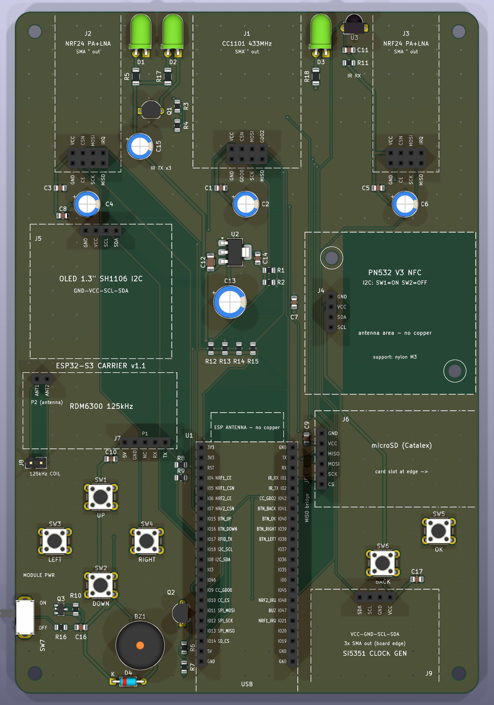

# ESP32-S3 Carrier Board (KiCad 10)

A 2-layer handheld carrier PCB for the ESP32-S3-DevKitC-1 (N16R8). Every module plugs into 2.54 mm female header sockets; the board itself only carries the sockets, buttons, power circuitry, IR parts and passives.



| | |
|---|---|
| Board | 116 × 170 mm, 2 layers, 1.6 mm FR4, R4 rounded corners, 4× M3 holes (5 mm from the edges) |
| Modules | CC1101 433 MHz (top centre), 2× NRF24L01+PA+LNA, PN532 V3 (I2C), RDM6300 125 kHz, Si5351 clock generator (3× SMA), Catalex microSD, 1.3" SH1106 I2C OLED |
| On board | 3× IR LED (940 nm) + VS1838B receiver, passive buzzer, 6 buttons (D-pad + OK + BACK), module power switch with soft-start, AMS1117-3.3 |
| ERC | **0 errors, 0 warnings** (`output/ERC_report.rpt`) |
| DRC | **0 violations, 0 unconnected pads, schematic ↔ PCB in sync** (`--schematic-parity --severity-all`, `output/DRC_report.rpt`) |
| Routing | Freerouting 2.5.0, 100 % routed; GND pour on both layers + 240 stitching vias |
| Tracks | signal 0.25 mm, power 0.6 mm, GND 0.5 mm, minimum 0.20 mm; clearance 0.20–0.25 mm; vias 0.6/0.3 and 0.8/0.4 mm |

## Files

| File | Contents |
|---|---|
| `ESP32S3_Carrier.kicad_pro / .kicad_sch / .kicad_pcb` | KiCad 10 project |
| `Carrier.kicad_sym`, `Carrier.pretty/` | Project symbols and module socket footprints (module body on Fab + courtyard) |
| `output/board_explorer.html` | **Interactive 3D board explorer**: open it in a browser, toggle layers, pull them apart, click a track to light up its whole net and list the connected pins |
| `output/render_top.png`, `render_perspective.png`, `render_bottom.png` | 3D renders |
| `output/assembly_1to1.pdf` | **1:1 assembly check drawing** (A4, unscaled, 50 mm check bar) |
| `output/copper_layers_1to1.pdf` | Top and bottom copper, 1:1 |
| `output/schematic.pdf` | Schematic |
| `output/ERC_report.rpt`, `output/DRC_report.rpt` | Check reports |
| `output/gerbers_ESP32S3_Carrier.zip` | Fabrication files (Gerber + Excellon) |
| `output/BOM.csv` | Bill of materials |
| `scripts/` | Regenerates everything from one source file (`design.py`) |

## Pin map (ESP32-S3)

| Function | GPIO |
|---|---|
| I2C SDA / SCL (OLED 0x3C, PN532 0x24, Si5351 0x60) | IO8 / IO18 (4.7k pull-ups to +3V3_MOD) |
| SPI MOSI / SCK / MISO (CC1101, microSD, 2× NRF24) | IO11 / IO12 / IO13 |
| CC1101 CS / GDO0 / GDO2 | IO10 / IO9 / IO42 |
| microSD CS | IO14 |
| NRF24 #1 CE / CSN / IRQ | IO4 / IO5 / IO21 |
| NRF24 #2 CE / CSN / IRQ | IO6 / IO7 / IO48 |
| IR receiver VS1838B | IO1 |
| IR transmitter (Q1 PN2222A, 220 Ω base, 3 LEDs) | IO2 |
| Passive buzzer (Q2 driver) | IO47 |
| Buttons UP / DOWN / LEFT / RIGHT / OK / BACK (pull to GND) | IO15 / IO16 / IO38 / IO39 / IO40 / IO41 |
| RDM6300 TX (5 V → 3.4 V divider) | IO17 |
| Unused | 0, 3, 19, 20, 35–37, 45, 46, TX/RX, RST |

Enable the internal pull-ups for the buttons. On DevKitC-1 v1.1, IO38 also drives the on-board RGB LED, so the button works but the RGB LED cannot be used at the same time. GDO2 and the two NRF24 IRQ lines are optional; firmware may ignore them.

## Power

```
USB → DevKit 5V pin → +5V ──[Q3 AO3401A, soft-start]── +5V_MOD ──┬─ microSD (5 V), RDM6300 (5 V), 3× IR LED, buzzer
                     SW7 slide switch drives Q3's gate          └─ U2 AMS1117-3.3 → +3V3_MOD → CC1101, 2× NRF24, PN532, OLED, Si5351, VS1838B
```

- **SW7 OFF:** the ESP32 keeps running, every module is unpowered.
- **Soft-start:** R16 (100k) + C16 (100 nF gate-drain) ramp +5V_MOD in about 20 ms. Without it, switching ~900 µF of module capacitance on at once would pull the DevKit's 5 V rail down and reset the ESP32.
- The modules' 3.3 V comes from a separate AMS1117, not from the DevKit's 3V3 pin (two PA+LNA radios + PN532 + Wi-Fi would overload the DevKit regulator).
- Decoupling: 100 nF at every module's VCC; an extra 100 µF at the CC1101 and both NRF24s; 470 µF bulk on +3V3_MOD; a 100 µF reservoir next to the IR LEDs.
- Peak current can approach 1 A, so use a decent USB port or charger. Under load +5V_MOD may sit near 4.5 V; if +3V3_MOD sags, replace U2 with a low-dropout SOT-223 regulator that has the same pin-out (1 GND, 2 VOUT, 3 VIN).
- While SW7 is off, firmware should not drive module pins (CS etc.) high, otherwise the modules get back-powered through their I/O pins.

## Design review (rev 1.1)

All connections were re-checked pin by pin against the module pin-outs (`scripts/netcheck.py` compares the schematic netlist with `design.py`). Changes from rev 1.0:

1. **Inrush fix (bug):** module power is now soft-started (see above).
2. **IR receiver:** rotated 180° so the lens faces the board edge (it faced inwards); added an R11/C11 (100 Ω / 100 nF) supply filter as recommended in the VS1838B datasheet.
3. **IR transmitter:** three IR LEDs, each with its own 33 Ω resistor (~95 mA peak each, ~0.3 A total through Q1), plus a 100 µF local reservoir.
4. **SPI chip selects:** 10k pull-ups (R12–R15) keep every SPI device deselected while the ESP32 boots.
5. **CC1101 moved to the centre** of the top edge; the NRF24s sit at the corners with the IR parts in between.
6. **Si5351 added** on the shared I2C bus, bottom right, with its three SMA outputs over the bottom edge.
7. CC1101 GDO2 and both NRF24 IRQ lines are now routed to free GPIOs.
8. Everything (silkscreen, schematic, files) is in English.

## Dimensions to verify before ordering (IMPORTANT)

The modules are unbranded clones; the footprints use the assumptions below. **Before ordering, print `output/assembly_1to1.pdf` at 100 % / "actual size", check the 50 mm bar with a ruler and lay the modules on the paper.**

> **2×4 sockets (J1 CC1101, J2/J3 NRF24):** a 2×4 header lands in the holes whether it is the right way round, rotated 180° or mirrored, so "the pins fit" proves nothing. Hold the module face up with the SMA pointing away and match the **module's own GND label / square pad** with **GND** on the printout: GND is the bottom-left pin (outer row left to right GND-CE-SCK-MISO, inner row VCC-CSN-MOSI-IRQ). The NRF24 orientation has been confirmed on a real module.

| Module | Assumed body | Header position (top view) | Source |
|---|---|---|---|
| ESP32-S3-DevKitC-1 | 25.4 × 62.74 mm (+~7 mm antenna overhang) | 2× 1×22, 22.86 mm apart; pin 22 is 8.00 mm from the USB end | Espressif v1.1 dimension drawing (DXF, 2022-04-29), exact |
| CC1101 433 MHz SMA | 27 × 40 mm + SMA | 2×4, centred at the end opposite the SMA; same pin pattern as the NRF24 | Owner's ~50×27 mm figure |
| NRF24L01+PA+LNA | 16.5 × 41 mm + SMA | 2×4 centred at the bottom end | Vendor pin-out drawings, confirmed |
| PN532 V3 | 42.7 × 40.4 mm | 1×4 on the left edge, ~6.5 mm in from the edge, vertically centred; 2 diagonal mounting holes | Elechouse V3 manual |
| Si5351 (4-pin) | 32 × 25 mm + 3 SMA | 1×4 centred on the edge opposite the SMAs (VCC-GND-SCL-SDA, left to right with the SMAs pointing up) | Typical 3-SMA module, **estimate** |
| OLED 1.3" SH1106 | 35.4 × 33.5 mm | 1×4 centred on the top edge | Typical module size |
| Catalex microSD | 42 × 24 mm | 1×6 on the short edge, card slot at the board edge | Typical module size |
| RDM6300 | 38.5 × 19 mm | P1 along the bottom edge on the right (TX right-most), P2 top left | RDM630 drawing (approximate) |

Tightest gaps between module bodies (plan view): PN532 ↔ DevKit ~1.8 mm, PN532 ↔ C6 ~3.9 mm, PN532 ↔ microSD ~4.1 mm. The PN532 header position was measured from a photo, so check these on paper first.

## Assembly notes

- Female sockets: 2× 1×22, 3× 2×4, 3× 1×4 (PN532, OLED, Si5351), 1× 1×6, 1× 1×5, 1× 1×2 (+ a 1×2 male header for J8). Standard 8.5 mm tall sockets fit.
- Solder straight (not right-angle) male pins to the PN532, pointing down; DIP switch **I2C: 1 = ON, 2 = OFF**. The two holes at its corners are for nylon standoffs.
- The transistors are `PN2222A` (E-B-C). A `P2N2222A` is C-B-E, so check before soldering.
- The IR LEDs use a horizontal footprint and point out of the top edge.
- Keep the 125 kHz coil away from the GND pour and metal (for example on the enclosure lid).
- SMD parts use hand-solder friendly 0805/1206 footprints.

## Regenerating

Needs KiCad 10 (`D:\KiCad`), the Freerouting 2.5.0 jar and Java 25 (paths at the top of `scripts/build.py`).

```
D:\KiCad\bin\python.exe scripts\build.py all       # library → schematic → ERC → PCB → routing → pour → DRC → outputs → 3D explorer
D:\KiCad\bin\python.exe scripts\build.py outputs   # outputs only
```

Change components, nets or positions in `scripts/design.py`; the schematic and the PCB are generated from the same data, so they always match.
